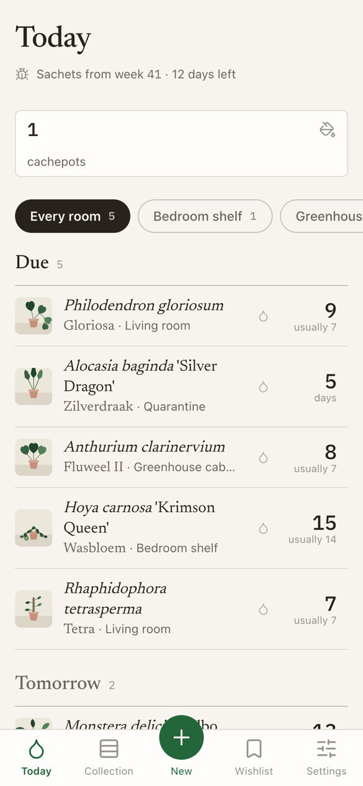
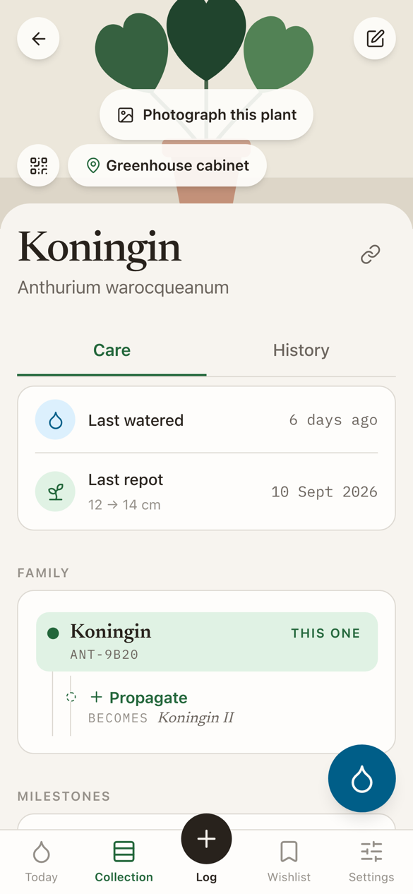
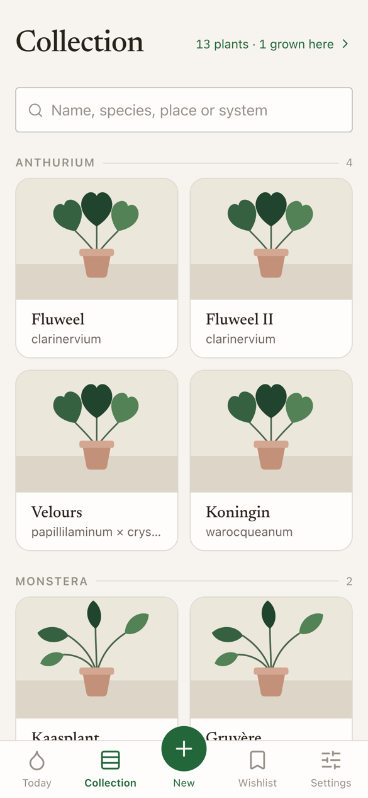
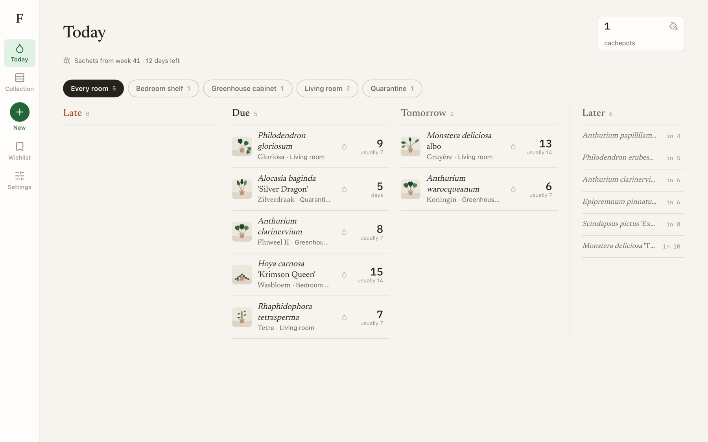
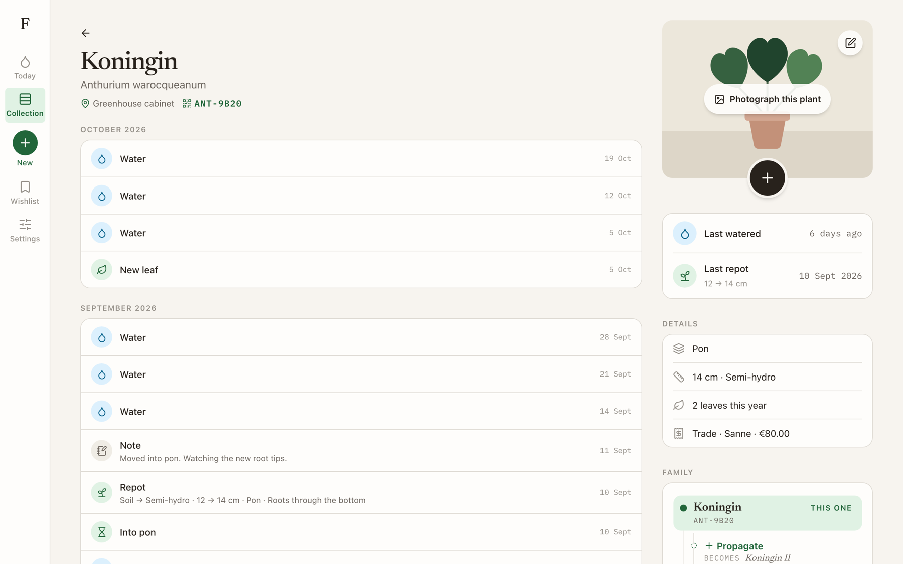

# Florarithm

A plant logbook you open by tapping the tag on the pot. Stick an NFC tag on a
plant, hold your phone against it, and the app opens on that plant, ready to
log a watering.

Live at **https://mptrs.github.io/Florarithm/**

Everything lives on your own device. There is no account, no server and no
database; a private GitHub repository can keep a copy in sync if you want one.

<p>
  
  
  
</p>



## What it does

- **Today.** Every plant comes onto Today a day before its own usual gap
  between waterings runs out, grouped by room and ordered by need. The days
  figure is the watering button. Chores sit above it as tiles: cachepots to
  empty the day after a soil plant was watered, plants settling in, and the
  predatory-mite sachets.
- **A tag opens the plant.** The sticker carries `…/Florarithm/#p=MON-8F3A`,
  which lands on that plant with the drop in reach. One tap waters it, with
  fertiliser, because that is how every watering goes. Every plant page also
  carries a QR code for the day the sticker gives up.
- **A log, not a form.** Watering, repotting (which updates the pot, medium
  and system of the plant itself), new leaves, blooming, notes and
  photographs, each of them datable. A wrong entry is dragged left to delete
  it or right to edit it.
- **The collection reads by genus.** Search is the only control: type a name,
  or pick a place, genus or system as a tag. Inside a genus the epithet leads,
  so a cross and the cultivar selected out of it land next to each other.
- **Family.** Cuttings and divisions point at their parent, and names continue
  the line: Fluweel, Fluweel II, Fluweel III.
- **Settling in.** A few weeks of different care on a fixed schedule:
  hardening off a plant from tissue culture, the first weeks in pon, or a
  stay in quarantine.
- **Wishlist and milestones.** Plants you want sit in the same table as plants
  you have; "I have this now" flips one flag. Milestones are read straight out
  of the log, with nothing to unlock.
- **Sync and backup.** A private GitHub repository, reached with a
  fine-grained token, keeps the data and photographs. A single JSON export goes
  through the share sheet into Files.

What it deliberately does **not** do is predict when a plant needs water. It
shows each plant's own rhythm, looking backwards, and stops there.



## Running it

```bash
npm install
npm run dev        # http://localhost:5173/Florarithm/
npm run build      # typecheck, then a static build into dist/
npm test           # Playwright: logic, then the app on WebKit and Chromium
```

Pushing to `main` runs the tests and, if they pass, deploys to GitHub Pages.

## How it is put together

```
src/
  lib/         pure helpers: plant codes, hash routing, dates, images, names
  data/        the model, IndexedDB, the store, selectors, sync and backup
  ui/          the design system as components (see DESIGN.md)
  layout/      the shell: tab bar on a phone, a rail on a desktop
  screens/     one file per screen
```

Dependencies run one way: `screens` use `ui`, `data` and `lib`; `ui` uses
`lib`; `lib` uses nothing. Runtime dependencies are React, `idb` and
`qrcode-generator`. `@mlc-ai/web-llm` is only loaded through a dynamic
`import()` for the optional AI name suggester.

### Conventions

- **Never store a derived value.** Days since water, rhythm, leaves this year:
  all of it is computed in `selectors.ts` at render time.
- **Events are append-only.** Deleting one sets `deleted: true`, so a sync
  merge cannot bring it back.
- **Colour, type, spacing and motion come from tokens.** `src/styles.css`
  clears Tailwind's stock palette; every colour is a token like `bg-water`,
  carrying both themes through `light-dark()`. `DESIGN.md` is the full system.
- **Components choose their look with variant props.** `className` is for
  placement only. See `lib/cn.ts`.
- **One markup, two layouts.** Phone and desktop differ by breakpoint, never by
  a JavaScript viewport check.
- **Anything that writes data is at least 44px tall**, and inputs never go
  below 16px, or Safari zooms in on focus.

## Writing a tag

1. Add the plant. It gets a code like `MON-8F3A`.
2. On the plant page, tap the link icon to copy its address.
3. Paste it into NFC Tools and write the sticker.
4. Write the code on the pot in marker too, and print the QR code alongside
   it. Both outlast the sticker.

The app cannot write tags itself: that needs Web NFC, which only exists in
Chrome on Android. Reading works everywhere, because the tag just holds a URL.
